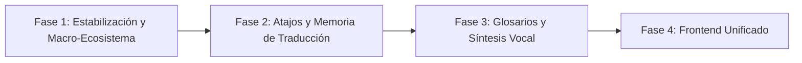

# 📋 Bitácora de Desarrollo y Hoja de Ruta (Roadmap)
## Proyecto: Traductor Local Offline (Selección con Ratón y Popup Flotante)

Esta bitácora establece el diagnóstico de arquitectura, el estado técnico, las deudas detectadas, el plan de trabajo evolutivo y el registro histórico de versiones del **Traductor de Texto Local**, integrado en la **Suite Macro de IA Local**.

---

## 🧭 1. Visión y Diagnóstico de Arquitectura (v1.0.0)

El proyecto proporciona traducción neuronal instantánea (Inglés ↔ Español) en cualquier ventana de Windows (navegadores web, documentos PDF, entornos de desarrollo, clientes de correo) mediante selección con el ratón, sin enviar jamás el contenido a servicios en la nube ni depender de conexión a internet.

### Fortalezas Clave
- **100% Privado y Confidencial:** Ejecución local mediante modelos cuantizados en `CTranslate2` y vocabularios `SentencePiece`.
- **Integración Nativa con Windows:** Monitoreo global no invasivo con `pynput` y simulación segura de copia con `pyperclip` (`Ctrl+C`).
- **Botón Flotante Discreto (`文A`):** Aparece suavemente al soltar el ratón tras una selección de texto sin interrumpir el flujo del usuario.
- **Popup Flotante Adaptativo:** Ventana sin bordes (*frameless*), auto-ajustable al tamaño del texto, arrastrable, con 5 temas visuales modernos y regulador de transparencia.
- **Control de Instancia Única:** Named Pipe / Socket local `TraductorLocal_SingleInstance_2026` para enfocar la app existente sin duplicar procesos.

---

## 🔍 2. Deudas Técnicas y Oportunidades de Mejora

| ID | Área | Descripción de la Oportunidad / Deuda | Prioridad |
|---|---|---|---|
| **DT-TL01** | **Historial / Memoria** | Las traducciones actuales se descartan al cerrar el popup. No existe persistencia en `historial/` en Markdown o JSON. | **Media** |
| **DT-TL02** | **Atajos de Teclado** | Falta soporte para traducción directa mediante atajo de teclado global (ej. `Ctrl+C+C` o `Alt+T`) sin requerir clic en el botón flotante. | **Media** |
| **DT-TL03** | **OCR de Pantalla** | No traduce texto incrustado en imágenes o interfaces que bloquean el copiado nativo. | **Baja** |
| **DT-TL04** | **Pronunciación TTS** | Posibilidad de sintetizar el audio de la pronunciación de la frase en inglés localmente (ej: con Piper TTS o SAPI5 local). | **Baja** |
| **DT-TL05** | **Integración Macro** | Envío de términos técnicos y glosarios traducidos hacia el futuro frontend/dashboard de la suite. | **Alta** |

---

## 🗺️ 3. Plan de Trabajo y Fases de Evolución

### 🔹 Fase 1: Estandarización y Macro-Ecosistema (En Progreso)
- [x] Unificación de Git en rama `main` y control de versiones profesional.
- [x] Generación de suite completa de documentación técnica en carpeta `doc/`.
- [x] Sincronización del estándar de sockets IPC con `12_Lanzador-Apps-IA`.
- [x] Pruebas automatizadas de traducción y captura de ratón verificadas.

### 🔹 Fase 2: Atajos Globales y Memoria de Traducción
- [ ] Atajo global de teclado configurable (ej. `Ctrl+C+C` o `Win+Alt+T`) para traducir instantáneamente la selección.
- [ ] Módulo `TranslationHistoryManager`: registro opcional de traducciones en `historial/` con formato Markdown (`.md`) y JSON (`.json`).
- [ ] Función de "Favoritos" o "Vocabulario Guardado" para estudio de idiomas.

### 🔹 Fase 3: Glosarios Personalizados y Audio TTS Local
- [ ] Soporte para glosarios técnicos definidos por el usuario (ej: términos de programación o ingeniería que no deben traducirse literalmente).
- [ ] Motor de síntesis de voz (Text-to-Speech) 100% offline con pronunciación nativa en inglés.

### 🔹 Fase 4: Integración en el Dashboard Unificado de la Suite
- [ ] Conexión con el Frontend / Visor Macro para consultar historial de términos, estadísticas de palabras traducidas y fichas de repaso.

---

## 📝 4. Registro Histórico de Cambios (Changelog)

Formato basado en [Keep a Changelog](https://keepachangelog.com/es-ES/1.0.0/) y versionado semántico.

### [1.1.0] - 2026-11-19
#### Añadido
- **Alineación con la Macro Suite de IA:** Normalización de la rama principal a `main`.
- **Suite de Documentación Técnica:** Incorporación de la carpeta `doc/` con arquitectura interna, flujo de captura, protocolo IPC, guía de uso e integración macro-sistema.
- **Bitácora Formal:** Creación de `BITACORA.md` con mapa de dependencias y backlog priorizado.

### [1.0.0] - 2026-11-12
#### Añadido
- Motor de traducción neuronal offline basado en CTranslate2 y ArgosTranslate (EN ↔ ES).
- Monitor global de selección de ratón (`pynput`) con detección de arrastre y doble clic.
- Botón flotante `文A` junto al cursor con temporizador de auto-ocultamiento.
- Ventana emergente (Popup) con auto-ajuste de tamaño, arrastre libre y regulador de opacidad.
- Soporte para 5 temas visuales: Oscuro Carbón, Oscuro Gris (Grafito), Oscuro Café (Moca Cálido), Oscuro Noche y Claro Suave (Nord).
- Control de instancia única vía `QLocalServer` (`TraductorLocal_SingleInstance_2026`).
- Lanzador silencioso en segundo plano (`iniciar.vbs`).
