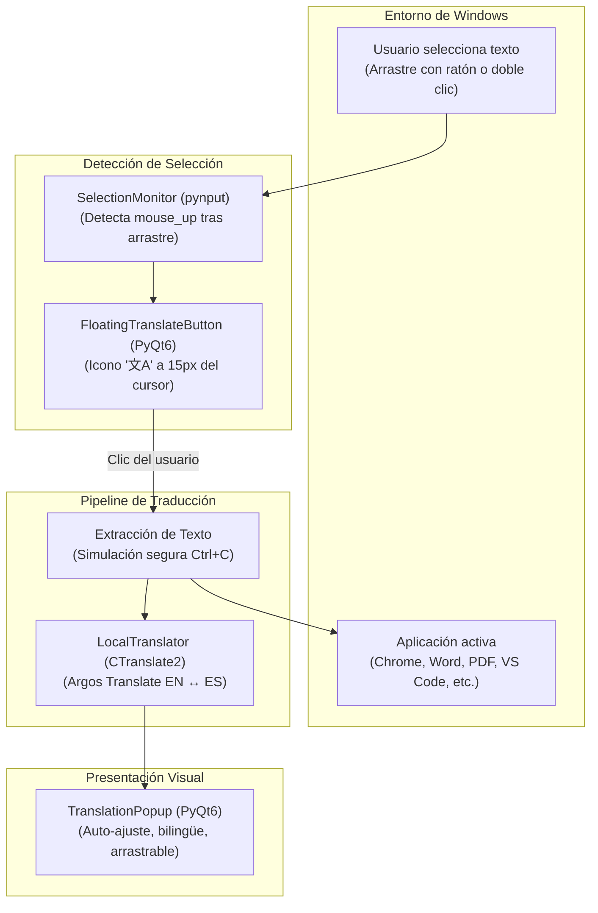

# 🏗️ 01. Arquitectura y Flujo de Procesamiento

Este documento detalla la arquitectura técnica interna de **Traductor Local Offline** y el ciclo de vida de un evento de traducción en pantalla.

---

## 🧭 Diagrama de Flujo

---

## 🧩 Módulos Principales

### 1. `SelectionMonitor` (`mouse_monitor.py`)
- Emplea `pynput.mouse.Listener` para escuchar eventos del ratón a nivel global del sistema operativo de forma asíncrona.
- Calcula la distancia Euclidiana entre la pulsación (`on_click down`) y la liberación (`on_click up`).
- Si la distancia supera el umbral configurado (ej: > 5 píxeles) o detecta un doble clic consecutivo, asume una selección de texto activa y emite la señal Qt con las coordenadas `(x, y)` finales del cursor.

### 2. `FloatingTranslateButton` (`floating_button.py`)
- Ventana translúcida sin bordes (*FramelessWindowHint*, *WindowStaysOnTopHint*, *Tool*).
- Se posiciona inteligentemente junto al cursor sin tapar el texto seleccionado.
- Posee un temporizador de auto-ocultamiento (4 segundos de inactividad) para no persistir si el usuario no desea traducir.

### 3. `LocalTranslator` (`translator_engine.py`)
- Carga los modelos neuronales entrenados para traducción de textos generales y técnicos (`argos-translate`).
- Emplea el motor CTranslate2 cuantizado para inferencia en CPU de ultra-alta velocidad (típicamente < 40 ms para un párrafo).
- Detecta automáticamente el idioma de origen (Inglés o Español) y selecciona el modelo adecuado (`en_es` o `es_en`).

### 4. `TranslationPopup` (`popup_window.py`)
- Ventana emergente adaptativa que calcula su ancho y alto según el volumen del texto traducido para evitar cajas vacías o textos cortados.
- Despliega el texto original y la traducción en cajas editables y copiables.
- Permite arrastre libre con el ratón por el encabezado.
