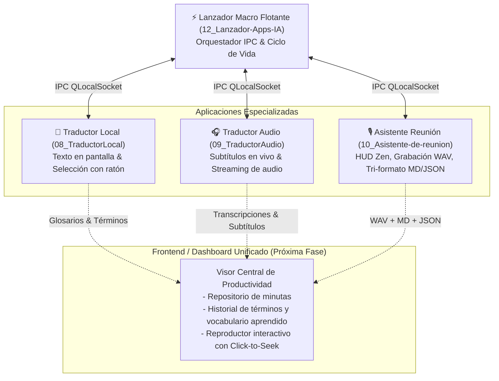

# 🌐 04. Integración en el Macro-Sistema de IA

Este documento describe cómo se articula el **Traductor Local Offline** dentro de la suite completa de herramientas locales de productividad e idioma.

---

## 🏛️ El Ecosistema Macro

El ecosistema local está concebido como una suite integral de productividad offline en Windows:

---

## 🔗 Puntos de Conexión y Compatibilidad

### 1. Entorno Virtual Compartido
Todas las herramientas apuntan por defecto al mismo entorno virtual de alta optimización en Windows:
`C:\Users\%USERNAME%\.audio_translator_venv`
Esto ahorra espacio en disco (evita duplicar Gigabytes de librerías como PyQt6, CTranslate2 y PyTorch/Whisper) y garantiza consistencia en las versiones de los paquetes.

### 2. Canales IPC Estandarizados
Cada aplicación cuenta con su canal Named Pipe único:
- `TraductorLocal_SingleInstance_2026`
- `TraductorAudio_SingleInstance_2026`
- `AsistenteReunion_SingleInstance_2026`
- `LanzadorSuiteIA_SingleInstance_2026`

El orquestador `12_Lanzador-Apps-IA` realiza un health check continuo (cada 2 segundos) para iluminar el estado en vivo de cada herramienta.

### 3. Paleta Visual Homogénea (Design System)
Las 4 aplicaciones comparten las definiciones de colores y bordes en `theme_config.py` (los 5 temas exactos), proporcionando una experiencia visual coherente al alternar entre el traductor de texto, los subtítulos de audio y el asistente de reunión.

### 4. Hacia la Memoria de Traducción y Glosario Común
En la Fase 2, las palabras y oraciones traducidas por `08_TraductorLocal` podrán persistirse en un archivo `historial/terminos.json` compartido, de modo que el **Traductor de Audio (`09_TraductorAudio`)** y el **Asistente de Reunión (`10_Asistente-de-reunion`)** reconozcan el vocabulario específico del usuario para mejorar la precisión fonética y contextual.
